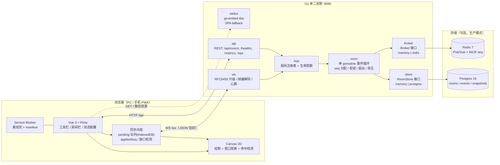
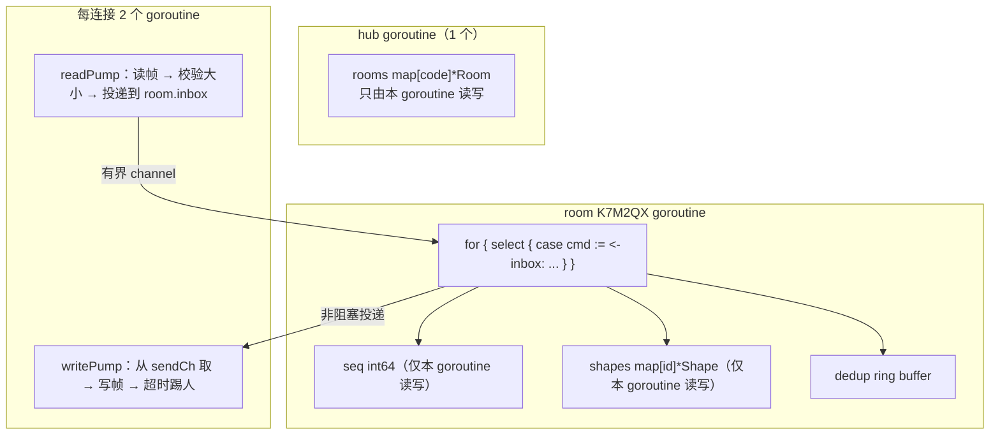
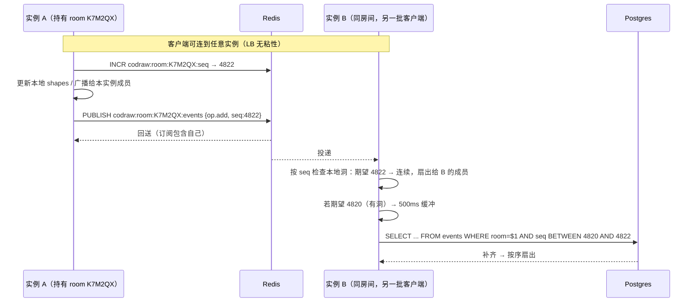

# 同绘 CoDraw · 架构设计

> 状态：已定稿｜负责人：架构师｜对应 PRD v1.0
> 一句话：**单二进制 Go 服务 + Canvas 2D 前端 + 每房间单 goroutine 的权威事件日志**，单实例零依赖可跑，加 Redis/Postgres 即可横向扩。

---

## 1. 系统全景



### 1.1 两条数据通道，各司其职

| 通道 | 用途 | 特征 |
|---|---|---|
| HTTP `/api/*` | 建房、查房间、签发只读 token、大房间快照分页、运维 | 无状态、可缓存、可被 CDN/反代处理 |
| WebSocket `/ws` | 实时消息：op、presence、resync、心跳 | 长连接、有状态、按房间隔离 |

> **不做** gRPC、不引消息队列中间件、不拆微服务。进程内模块用 Go 接口解耦，单二进制部署。

---

## 2. 进程内模块划分与依赖方向

```
cmd/server ──► api ──┐
             └► ws ──┴──► hub ──► room ──► store (interface)
                                          └► broker (interface)
                                       store ◄── store/memory, store/postgres
                                       broker ◄─ broker/memory, broker/redis
             webui（只被 api 引用，提供 embed FS）
             protocol（纯数据结构 + 校验，被所有层引用，零依赖）
```

**依赖规则（CI 可加 `go vet` + 人工 review 保证）**：

| 规则 | 理由 |
|---|---|
| `protocol` **不 import 任何内部包** | 它是契约的 Go 镜像，可被 ws/room/store 共用 |
| `room` **不 import `ws`** | 房间不认识 TCP，只认识 `Member` 接口（`Send(Envelope) bool`） |
| `room` **不 import `hub`** | 依赖倒置：hub 管理 room，room 不回头找 hub |
| `api`/`ws` **不直接碰 `store`/`broker`** | 一律经 `hub`，保证 seq 只在一个地方分配 |
| `store`/`broker` 只暴露接口 + 构造函数 | 切换实现只改 `main.go` 的一行 |

### 2.1 单实例内存模式 vs 生产模式

| 开关 | 取值 | 行为 |
|---|---|---|
| `BROKER` | `memory`（默认） | 单实例内直接扇出；跨实例广播不可用 |
| | `redis` | 订阅 `codraw:room:{code}:events`；seq 用 `INCR` |
| `STORE` | `memory`（默认） | 事件日志 + 快照全在进程内，重启即丢 |
| | `postgres` | 日志落 `events` 表、快照落 `snapshots` 表，重启可恢复 |

组合矩阵：

| BROKER | STORE | 场景 | 能力 |
|---|---|---|---|
| memory | memory | 本地开发、单测、演示兜底 | 全部实时功能，**重启丢数据** |
| memory | postgres | 单实例上线（推荐默认生产） | + 持久化、重启恢复、历史回放 |
| redis | postgres | 多实例演示（两个进程） | + 跨实例同步、连接分散 |
| redis | memory | 仅压测/临时 | 跨实例同步但重启丢数据，**不要用于生产** |

`main.go` 的装配逻辑（伪代码，仅表达边界）：

```go
st := store.New(cfg.Store, cfg.DatabaseURL)   // memory | postgres
br := broker.New(cfg.Broker, cfg.RedisURL)    // memory | redis
h  := hub.New(st, br, cfg)
srv := api.New(h, webui.FS(), cfg)
```

---

## 3. 并发模型

### 3.1 所有权：一个房间一个 goroutine



**核心不变量（写进 `room.go` 顶部注释）**：

1. `seq`、`shapes`、`members`、`dedup` **只能**在房间 goroutine 内访问，无需锁。
2. 连接 goroutine 与被管理对象之间**只通过 channel 通信**，不共享可变状态。
3. 房间 goroutine **绝不阻塞**：所有出站投递用 `select { case ch <- msg: default: 标记慢消费者 }`。

**为什么不用全局 mutex**：一个房间一把锁在 100 人同时绘制时会形成热点，且锁内做 JSON 序列化会让 p95 直接崩。单 goroutine 串行化把"顺序"这件事变成结构保证，而不是靠加锁纪律。

### 3.2 消息队列与背压

| 队列 | 容量 | 满时策略 |
|---|---|---|
| `room.inbox`（连接 → 房间） | 1024 | 投递方（readPump）**阻塞最多 100ms**；仍满 → 断开该连接（`4001`），客户端重连用 seq 补齐 |
| 每连接 `sendCh`（房间 → 连接） | 256 条 / 1MB | **丢弃非持久消息**（cursor/presence）；持久 op 无法入队超 5s → `4001` 关闭 |
| `broker` 订阅缓冲 | 4096 | 有洞时回源 Postgres 补齐（§4.2） |

**关键设计：慢消费者只影响自己。** 因为持久消息进不了队就断开，客户端重连时用 `lastSeq` 补齐，**数据零丢失**；而丢弃 cursor 只是"光标卡住"，用户无感。这是"有界缓冲 + 慢消费者处置"的全部内容，面试可直接画这张表。

### 3.3 优雅停机顺序

```
SIGTERM
  │
  ├─1. 停止接受新连接（listener.Close；/readyz 立刻返回 503）
  ├─2. 向所有连接发 presence.leave（不等待）+ close 1001
  ├─3. 等待 3s 让 writePump 把剩余帧刷完（或直到全部退出）
  ├─4. 并行：每个房间 goroutine 收到 shutdown → 刷最后一条快照/日志 → 退出
  ├─5. store.Close()（Postgres 连接池 flush）→ broker.Close()（取消订阅）
  └─6. 进程退出；总预算 5s，超时强制 exit(1)
```

**为什么先关连接再刷盘**：先让客户端知道"要重连"，避免客户端把停机当成网络抖动而无限重试同一实例；刷盘放在房间 goroutine 内完成，保证每房间的日志与 seq 一致。

### 3.4 一个 op 的完整生命周期

```
writePump 读帧(≤64KB) → ws 解析 → protocol.Validate(结构)
  → room.inbox ← Cmd{op}
  → [房间 goroutine]
      鉴权(role) → 令牌桶 → 业务校验 → seq++ → 更新 shapes
      → store.Append(events)（error 则回滚内存并 ack rejected）
      → 扇出：对每个 member 非阻塞投递 op.add
      → 发给发起者 ack{applied, seq}
```

> **先落库再广播**：保证"客户端看到的 seq 一定可被补齐"。代价是 p95 增加一次 DB 往返（本地网络 ~1ms）；`STORE=memory` 时无此开销。

---

## 4. 第 2 个实例接入后的数据流



### 4.1 seq 分配策略（多实例）

| 方案 | 是否采用 | 理由 |
|---|---|---|
| 单实例 `atomic` 自增 | 单实例用 | 零依赖，最快 |
| **Redis `INCR` 每房间计数器** | **生产采用** | O(1)、跨实例唯一、天然单调；失败可重试 |
| Postgres `SEQUENCE` | 备选 | 需额外表管理，且与事件插入非原子 |
| 分布式选主 + 单写者 | **不做** | 引入复杂度，3 天工期不划算 |

**为什么 `INCR` 足够**：seq 只需**唯一 + 单调**，不要求"分配即落库原子"。极端情况下实例 A 分配到 4822 后崩溃未广播 → 后续实例从 4823 继续 → 客户端看到洞 → 触发 `resync` 从 Postgres 补齐（4822 确实没写入，则补齐逻辑返回"从 4822 起可用的最大连续段"，客户端直接跳到 4823）。**空洞由客户端 resync 兜底，这是有意的取舍而不是漏洞**，写在 ADR 里。

### 4.2 跨实例乱序

Redis Pub/Sub **不保证**跨发布者的顺序（单频道内按发布顺序，但多实例并发 PUBLISH 时到达顺序可能交错）。因此：

- 每个实例维护 `expectedSeq[room]`；收到 `seq > expected` → 进 `pending` 缓冲（最多 256 条 / 500ms）。
- 超时仍有洞 → **回源 Postgres 按 seq 范围查询**补齐（`STORE=postgres` 时可用）。
- `STORE=memory` + `BROKER=redis` → 无法回源，只能等；因此该组合**不推荐**（矩阵里已标注）。

---

## 5. 关键取舍（ADR 摘要）

### ADR-1：服务端权威日志 + 单调 seq，而非 CRDT / OT

| 维度 | 本方案 | CRDT | OT |
|---|---|---|---|
| 实现成本 | 低（一个 `int64` + 一个 `map`） | 高（每种图形都要设计 CRDT 类型） | 高（需要 transform 函数与服务端转换） |
| 正确性保证 | 服务端单一顺序，**所有客户端最终一致** | 数学上强，但工程实现易错 | 需中心服务器 + 复杂转换 |
| 白板真实需求 | 图形是**整体对象**，冲突用 LWW 可接受 | 过度设计 | 主要适合文本 |
| 断线重连 | 天然支持（seq 补齐） | 需要状态向量交换 | 需要 operation buffer |
| 面试叙事 | 清晰、可讲清"为什么不用" | 容易被追问实现细节 | 同理 |

**结论**：白板 99% 的并发是"不同人在不同区域画不同图形"，本来就不冲突；同一图形的并发编辑用 LWW 完全够用。CRDT 的成本换不来产品价值。**P1 的撤销/重做**用"逆操作入日志"实现，也不需要 CRDT。

### ADR-2：Canvas 2D，而非 SVG / WebGL

| 维度 | Canvas 2D | SVG | WebGL |
|---|---|---|---|
| 1 万图形性能 | 好（单画布，重绘可控） | 差（DOM 节点爆炸） | 最好 |
| 开发成本 | 低 | 中（事件命中简单） | 高（着色器、批处理） |
| 中文文本 | `fillText` 直接可用 | 好 | 需纹理图集，中文麻烦 |
| 移动端 | 好 | 一般 | 需处理上下文丢失 |
| 导出 PNG（P1） | `toDataURL` 一行 | 需序列化 | 需 readPixels |

**结论**：Canvas 2D 在 1 万图形量级足够；配合**脏矩形 + 分层画布**（静态层/动态笔迹层/光标层）可稳定 60fps。WebGL 对 3 天工期是负债。

### ADR-3：PWA 而非原生 / 桌面壳

- 一套代码覆盖 PC + Android，符合 PRD「移动 Web 优先」。
- Service Worker 提供**离线壳**：断网仍能打开已访问过的房间（配合 IndexedDB 中的快照与 pending），这正是 F6 的体验基础。
- 代价：无系统级手写笔压感（`pointer.pressure` 在部分 Android 浏览器不可用）→ P0 不依赖压感。

### ADR-4：单二进制 + `go:embed`

- 前端产物打进后端二进制，部署只有**一个容器、一个端口**，没有 CORS、没有反代配置错误。
- 镜像用 `scratch`/`alpine` 多阶段构建，目标 < 60MB。
- 开发期 Vite 5173 代理 `/api` 与 `/ws`，生产期同源，**前端零环境切换**。

### ADR-5：JSON 而非二进制协议

- 可读、可调试、浏览器原生 `JSON.parse`，配合 64KB 上限不会成为瓶颈。
- 若未来需要，可在 `ws` 层加 permessage-deflate（Go 侧 `compress` 选项），**协议不变**。

---

## 6. 容量与失效分析

### 6.1 单房间 100 人

| 项 | 估算 | 结论 |
|---|---|---|
| 每人 60 ops/s 上限（实际绘制约 20–30/s） | 100 × 30 = **3000 msg/s 入站** | 房间 goroutine 串行处理，每条约 5–20µs（校验 + map 更新），**约 15–60ms/s CPU**，远未饱和 |
| 扇出 | 3000 × 100 = **30 万 msg/s 出站** | **这是真正的瓶颈**：每条约 200B → 60MB/s |
| 单连接 256 缓冲 | 30 万/100 = 3000 msg/s/人 | 缓冲 **<100ms** 就会满 → 慢消费者被踢 |

**结论与解释（面试重点）**：100 人同房间**同时持续绘制**不是真实场景（人眼无法同时看 100 条笔迹）。设计上保证：
- 单房间 **200 连接**上限，防止扇出爆炸；
- cursor 20Hz **在服务端合并节流到 50ms**，把 presence 流量压到 100 × 20 = 2000 msg/s；
- op 广播前**按房间序列化一次**，复用同一 `[]byte`（不是每人序列化一次）——这一点能把 CPU 从扇出的平方级开销降到线性。
- 真实演示（2–5 人）时 p95 < 30ms 轻松达标；压测 100 人时用「每人 5 ops/s」的可信场景，仍可讲清瓶颈在哪。

### 6.2 单实例 1000 连接

| 资源 | 估算 |
|---|---|
| goroutine | 1000 × 2（read/write）+ 房间数 ≈ **2100**，Go 默认栈 2KB → ~4MB |
| 每连接缓冲 | 256 条 × 200B ≈ 50KB → 1000 × 50KB = **50MB**（可调小到 128 条 → 25MB） |
| 房间状态 | 假设 200 房间 × 平均 500 图形 × 500B ≈ 50MB |
| 总计 | **~150MB RSS**，符合小规格容器 |

瓶颈点：**文件描述符**（默认 1024）与 **GC 压力**。措施：`ulimit -n 65535`、`GOMEMLIMIT`、复用 `sync.Pool` 缓冲。

### 6.3 5k msg/s

- 入站 5k msg/s 对单核是**可行**的（每条 JSON 解析 ~2–5µs → 10–25ms/s）。
- 出站放大是关键：若平均扇出 20 人 → **10 万 msg/s**，即 20MB/s。这已接近单机网卡与 Go 写循环的上限。
- 措施：**批量写**（每 10ms 或 64 条 flush 一次）、`bufio.Writer`、同房间共享序列化结果、`wmem` 调大。
- **明确的失效点**：单实例在"1000 连接 × 平均扇出 50 × 10 msg/s" = 50 万 msg/s 时会先出现**写阻塞**而非 OOM；此时慢消费者踢除机制启动，表现为部分客户端频繁重连——这是可观测、可告警的降级，而不是雪崩。

### 6.4 存储容量

| 数据 | 体积 | 保留策略 |
|---|---|---|
| 1 op | ~200B（JSONB） | 每房间最近 5000 条热日志 |
| 5000 ops | ~1MB/房间 | 超出后归档到 `events_archive` 或删除 |
| 快照 | 500 图形 ≈ 250KB → gzip 后 ~40KB | 每 500 ops 或 5 分钟一次，保留最近 3 个 |
| 1000 房间 | 日志 1GB + 快照 120MB | 可接受 |

---

## 7. 安全边界

| 面 | 措施 |
|---|---|
| 只读强制 | 服务端 hub 入口校验 `role`，viewer 的 `op.add` 直接 `ack{rejected, forbidden}` |
| 密钥泄露 | 只存 `sha256(key)`；日志对 `key`/`rt` 打码；只读 token 带 `exp` 可撤销 |
| XSS | 昵称与便签文本**纯文本渲染**（`textContent`），服务端截断长度；CSP `default-src 'self'` |
| CSWSH | 严格 `Origin` 白名单，无 Origin 默认拒绝 |
| 资源耗尽 | 64KB 帧上限、60 ops/s 令牌桶、200 连接/房间、5000 连接/实例 |
| 枚举房间 | 6 位 32 字符集 ≈ 10.7 亿组合；建房限流 + 加入失败限流（P1） |
| 依赖 | 仅 `net/http` + 1 个 WS 库 + `pgx` + `go-redis`；无 ORM |

---

## 8. 可观测性

| 指标 | 类型 | 用途 |
|---|---|---|
| `codraw_ws_connections{instance}` | Gauge | 连接数 |
| `codraw_rooms` | Gauge | 活跃房间数 |
| `codraw_msg_in_total` / `codraw_msg_out_total` | Counter | 吞吐 |
| `codraw_broadcast_latency_seconds` | Histogram | **p95 广播延迟**（F11 面板直接读） |
| `codraw_slow_consumer_kicks_total` | Counter | 背压是否触发 |
| `codraw_seq_gap_total` | Counter | 客户端报告缺口次数（多实例健康度） |
| `codraw_store_errors_total` | Counter | 落库失败 |
| `codraw_goroutines` / `codraw_heap_bytes` | Gauge | 泄漏排查 |

`/ops` 面板复用同一份内存快照，**不额外打点**。

---

## 9. 与 PRD 的一致性说明

| PRD 约束 | 落地 |
|---|---|
| F6 断网 60s 零丢失零重复 | PROTOCOL §6.3/6.4/6.5：IndexedDB pending + 原 opId 重放 + seq 连续校验 + `(cid,opId)` 幂等窗口 |
| F8 只读不可写 | PROTOCOL §0.1 + §1.3/1.4：服务端角色裁决 + HMAC 只读 token（可撤销、限时） |
| 单实例零依赖 | `BROKER=memory` + `STORE=memory` 默认值，无外部进程 |
| Redis 仅用于广播与序号 | §4：`INCR` 分配 seq + Pub/Sub 扇出，`redis` **不做**状态存储 |
| 镜像 < 60MB | 多阶段 + `CGO_ENABLED=0` + `-ldflags "-s -w"`；前端 gzip 后 < 1MB |
| 端口 8080 / 5173 | 后端 8080；Vite dev 5173 代理 `/api` 与 `/ws` |

**唯一的补充（不冲突）**：PRD 未定义只读 token 的撤销机制，本设计用「房间级 `readonlyMinIssuedAt` 时间戳」实现**无状态可撤销**，比逐 token 存库更省，且满足 F8「生成带签名的只读链接」。
