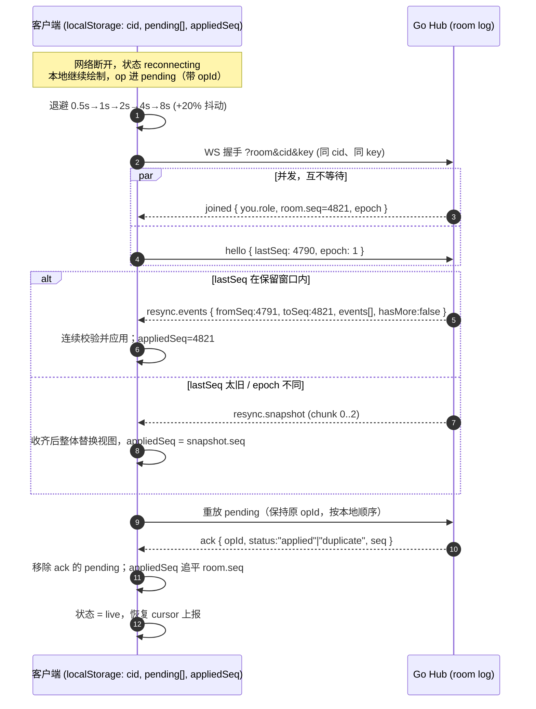

# 同绘 CoDraw · 协议契约 v1（PROTOCOL）

> 状态：**冻结**（2026-11-23）｜负责人：架构师｜Go 与 Vue 两位工程师的**唯一契约**
> 协议版本：`v = 1`｜传输：HTTP/1.1 + WebSocket（RFC 6455）+ JSON（UTF-8）
>
> **实现与本文冲突时，先改本文再改代码。** 任何字段、类型、可空性、错误码的变更都需要架构师确认。

---

## 0. 全局约定

| 项 | 约定 |
|---|---|
| 编码 | JSON，UTF-8，**禁止 BOM**；单条 WS 文本帧 ≤ **65536 字节**（UTF-8 计） |
| 信封必备 | 每条 WS 消息必须含 `v`（int）与 `type`（string）；其余见 §2 |
| 时间 | 毫秒级 Unix 时间戳（int64），统一字段名 `ts`；服务端时间为准 |
| ID 字符集 | `^[A-Za-z0-9_-]{8,40}$`（UUIDv4 去横线、nanoid 均可） |
| 房间码 | 6 位，字符集 `23456789ABCDEFGHJKMNPQRSTUVWXYZ`（**31 字符**，排除 `0 O 1 I L`）；服务端统一转大写，入参大小写不敏感 |
| 坐标 | 世界坐标，float64，合法范围 `[-1e6, 1e6]`；拒绝 NaN / ±Inf |
| 颜色 | `#rrggbb` 小写；**由服务端分配**，客户端提交值被忽略 |
| 未知字段 | 接收方**必须忽略**，不得报错（前向兼容） |
| 未知 `type` | 回 `error{code:"unsupported_type"}`，`fatal:false`，连接保持 |
| 枚举降级 | 遇到未知 `shape.kind`：**保留数据、不渲染、不删除**（防止跨版本误删） |

> 房间码熵：31⁶ ≈ **8.87 亿**组合，配合 6 位可读性（无 `0 O 1 I L`）在"易读"与"不可枚举"之间取平衡；配合 ip 限流，暴力枚举不可行。

### 0.1 角色与鉴权（F8 的核心，必须服务端强制）

> **本节已被 `docs/PERMISSIONS.md` 取代（2026-11-24）。** 角色不再由 `key` 决定：
> 房间有 `owner`/`editor`/`viewer` 三档，第一个进入房间的连接成为 `owner`，
> `editorKey` 退化为**邀请凭证**（持它进来仍是 `viewer`，需房主授权）。
> 只读 token（`rt`）仍强制 `viewer`，且**永远不可被提升**。
> 权威规则见 `docs/PERMISSIONS.md` §1/§2/§4.2；本节只保留握手层的实现约束。

- 建房时仍生成两把随机密钥，各 32 字节，base64url 无填充（43 字符）：`editorKey`、`viewerKey`。
- 服务端**只存 `sha256(key)`** 的十六进制值，不存明文，日志中 `key` 必须打码为 `k=***`。
- 握手 URL 里的 `key` **只用于校验邀请凭证是否有效**，不再直接映射角色。
- `editorKey` 仍是签发/撤销只读 token 的凭证（§1.3、§1.4）。
- 客户端可传 `role` 作提示，**权威角色只认 `joined.you.role`**。
- 非 `owner`/`editor` 的任何写意图（`op.add`）在 **room goroutine** 拒绝，返回
  `ack{status:"rejected", code:"forbidden"}`；绝不依赖前端禁用按钮。
- `owner` 隐含 `editor` 能力：服务端判定为 `role == "owner" || role == "editor"`。

> 分享链接 = 带 key 的 URL。只读链接泄露不影响数据完整性；编辑链接泄露也不再有编辑权，只代表"被邀请"。

---

## 1. HTTP API

Base path：`/api`。请求与响应均为 `application/json; charset=utf-8`。

统一错误体（所有 4xx/5xx）：

```json
{ "error": { "code": "room_not_found", "message": "room not found", "requestId": "req_7f3a91d2" } }
```

`code` 取值见 §9；`message` 仅供人读，**客户端只判断 `code`**。

### 1.1 创建房间

`POST /api/rooms`

```json
{ "title": "架构评审白板" }
```

| 字段 | 类型 | 必填 | 约束 |
|---|---|---|---|
| `title` | string | 否 | 去首尾空白后 1–60 字符；缺省 `未命名白板`；超长**截断**而非报错 |

响应 `201 Created`：

```json
{
  "room": {
    "code": "K7M2QX",
    "title": "架构评审白板",
    "createdAt": 1732358400000,
    "lastActiveAt": 1732358400000,
    "shapeCount": 0
  },
  "keys": {
    "editorKey": "9tK...(43 chars)",
    "viewerKey": "Qm2...(43 chars)"
  },
  "urls": {
    "edit": "https://codraw.example.com/r/K7M2QX?k=9tK...",
    "view": "https://codraw.example.com/r/K7M2QX?k=Qm2..."
  },
  "limits": {
    "maxMessageBytes": 65536,
    "maxShapeBytes": 32768,
    "maxShapesPerRoom": 20000,
    "opsPerSecond": 60,
    "opsBurst": 120,
    "cursorPerSecond": 20,
    "resumeMaxOps": 2000,
    "resumeMaxBytes": 4194304
  }
}
```

> `keys` **只在创建响应出现一次**，服务端不提供找回。丢编辑链接 = 丢编辑权限。
> `urls` 的 origin 取 `PUBLIC_BASE_URL`；未配置时按 `X-Forwarded-Proto` + `Host` 推导。

限流：按客户端 IP **10 次/小时**，突发 10；超限 `429` + `Retry-After`。

### 1.2 查询房间（公开元信息）

`GET /api/rooms/{code}`（可选 `?key=...` 用于回显角色）

```json
{
  "code": "K7M2QX",
  "title": "架构评审白板",
  "createdAt": 1732358400000,
  "lastActiveAt": 1732358460000,
  "shapeCount": 128,
  "online": 3,
  "role": "editor",
  "isFull": false
}
```

- `online` 为**本实例**连接数；多实例时是近似值，仅用于展示。
- 不带 key 或 key 不匹配 → `role:"viewer"`。
- `code` 格式非法 → `400 bad_request`（不查库，防扫描）；不存在 → `404 room_not_found`。

### 1.3 签发只读 token（F8）

`POST /api/rooms/{code}/readonly-token`

鉴权：必须持 `editorKey`（请求体或 `X-Room-Key` 头）。**只有编辑者能为访客签发只读凭证。**

```json
{ "editorKey": "9tK...(43 chars)", "ttlSeconds": 86400 }
```

| 字段 | 类型 | 必填 | 约束 |
|---|---|---|---|
| `editorKey` | string | 是 | 43 字符 base64url |
| `ttlSeconds` | int | 否 | 60–604800（7 天），默认 86400 |

响应 `200`：

```json
{
  "token": "eyJyb29tIjoiSzdNMlFYIiwi...",
  "role": "viewer",
  "expiresAt": 1732444800000,
  "url": "https://codraw.example.com/r/K7M2QX?rt=eyJyb29t..."
}
```

- `token` 是**无状态签名 token**（HMAC-SHA256，见 §1.7），服务端不落库。
- 为兼容 F8 的「只读分享」，`?k={viewerKey}` 亦可只读；`?rt=` 的优势是可**撤销与限时**（见下）。
- 仅传 `rt` 时 `role=viewer`，即使同时传了 `editorKey` 也按 viewer 处理（token 优先降权，绝不升权）。

### 1.4 撤销只读 token

`POST /api/rooms/{code}/readonly-token/revoke`

```json
{ "editorKey": "9tK...", "all": true }
```

响应 `200 { "revoked": true }`。实现方式：房间级 `readonlyMinIssuedAt` 时间戳，撤销后所有 `iat` 早于它的 token 失效（无需逐 token 存储）。

### 1.5 分页读取快照（大房间兜底）

`GET /api/rooms/{code}/snapshot?key=...&after={shapeId}&limit=500`

```json
{
  "seq": 4821,
  "epoch": 1,
  "shapes": [],
  "next": "sh_01H8Z3K4",
  "complete": false
}
```

- `limit` 默认 500，上限 1000；`after` 为上一页最后一个 `shape.id`，按 `id` 字典序翻页。
- 仅返回活图形（不含 tombstone）；`complete:true` 时 `next` 为 `null`。
- 用途：图形数 > 5000 或 WS 分块快照失败时降级。只读，editor/viewer 均可。

### 1.6 运维端点

| 端点 | 语义 | 成功 | 失败 |
|---|---|---|---|
| `GET /healthz` | 存活探针，**不查依赖** | `200 {"status":"ok"}` | 进程挂 |
| `GET /readyz` | 就绪探针，查依赖 | `200 {"status":"ready","store":"postgres","broker":"redis"}` | `503 {"status":"not_ready","reason":"postgres"}` |
| `GET /metrics` | Prometheus 文本格式 | `200 text/plain; version=0.0.4` | — |
| `GET /ops` | 运维面板 HTML（F11） | `200 text/html` | — |
| `GET /ops/data` | 面板 JSON 轮询源 | `200`，见下 | — |

`/ops/data`：

```json
{
  "instanceId": "i_7d1c",
  "uptimeSec": 3721,
  "connections": 128,
  "rooms": 17,
  "msgPerSecIn": 812.4,
  "msgPerSecOut": 5210.1,
  "broadcastLatencyP95Ms": 23.7,
  "slowConsumerKicks": 2,
  "goroutines": 431,
  "heapMB": 38.2,
  "store": "postgres",
  "broker": "redis"
}
```

`/metrics` 与 `/ops` 默认仅内网；设置 `METRICS_TOKEN` 时要求 `Authorization: Bearer <token>`。

静态资源：`/`、`/r/{code}`、`/assets/*` 由 `go:embed` 提供；未知非 API 路径回 `index.html`（SPA fallback），但 `/api/*` 与 `/ws` 的未知路径必须回 **404 JSON**，不得回 HTML。

### 1.7 只读 token 格式（HMAC，可验证）

```
base64url( header ) . base64url( payload ) . base64url( HMAC-SHA256(secret, header.payload) )
header  = {"alg":"HS256","typ":"CDRT"}                 // CDRT = CoDraw Readonly Token
payload = {"code":"K7M2QX","role":"viewer","iat":1732358400000,"exp":1732444800000,"jti":"..."}
secret  = READONLY_SECRET 环境变量（≥32 字节随机串）
```

校验：签名常量时间比较 → `exp > now` → `payload.code` 与路径一致 → `iat >= room.readonlyMinIssuedAt`。任一失败 → `403 forbidden`。

---

## 2. WebSocket 握手与信封

### 2.1 端点与查询参数

`GET /ws?room={code}&cid={clientId}&name={nickname}&key={editorKey|viewerKey}&rt={readonlyToken}`

| 参数 | 必填 | 说明 |
|---|---|---|
| `room` | 是 | 6 位房间码，大小写不敏感 |
| `cid` | 是 | 客户端实例 ID，**同一标签页生命周期内不变，重连必须复用** |
| `name` | 否 | 昵称 1–24 字符；缺省 `访客-{cid 前 4 位}`；服务端截断并转义 |
| `key` | 否 | `editorKey` / `viewerKey`；缺失即 viewer |
| `rt` | 否 | 只读 token；**存在时强制 viewer，忽略 key 的提权** |

> **`lastSeq` 不放 URL**：它属于同步状态而非身份，由升级后的首帧 `hello` 携带。这样刷新重连不会因为 URL 缓存产生陈旧的 `lastSeq`，也便于日志打码时只处理密钥类参数。

握手校验顺序（任一失败即返回 HTTP 错误，**不升级**）：

1. `Origin` 不在允许列表 → `403 forbidden`
2. `room` 格式非法 → `400 bad_request`；房间不存在/过期 → `404 room_not_found`
3. 连接数 ≥ `MAX_CONN_PER_ROOM`（默认 200）→ `429 room_full`（**未升级**时）；若连接已升级后才因并发加入判定为满（`joined` 之后、加入房间时），服务端先发 `error{code:"room_full",fatal:true}` 再以 close code **4002** 关闭——HTTP 状态码在升级后无法再改，客户端以「收到 `room_full`」为唯一判据即可，两条路径语义一致。
4. 实例总连接数 ≥ `MAX_CONN_TOTAL`（默认 5000）→ `503 server_busy`
5. 升级后 **10s 内未收到 `hello`** → 以 `1008` 关闭（服务端不等 `joined` 被消费，`joined` 是立即发出的）

HTTP 拒绝体：

```json
{ "error": { "code": "room_full", "message": "room is full", "requestId": "req_1a2b" } }
```

> 浏览器 WebSocket API 无法自定义 Header，鉴权只能走 query。**生产环境访问日志必须对 `key`/`rt` 打码。**

**Origin 规则**：允许 `PUBLIC_BASE_URL` 的 origin、`ALLOWED_ORIGINS`（逗号分隔）追加项；`APP_ENV!=production` 时额外允许 `http://localhost:5173`、`http://127.0.0.1:5173`。无 `Origin` 头默认拒绝，`ALLOW_EMPTY_ORIGIN=true` 时放行（仅压测）。

### 2.2 信封（两个方向统一）

```json
{
  "v": 1,
  "type": "op.add",
  "seq": 42,
  "roomId": "K7M2QX",
  "clientId": "c_7f3a91d2",
  "ts": 1732358400123,
  "payload": { }
}
```

| 字段 | 类型 | 服务端→客户端 | 客户端→服务端 | 说明 |
|---|---|---|---|---|
| `v` | int | 必填 | 必填 | 协议版本，当前恒 `1`；缺失按 `1` 处理 |
| `type` | string | 必填 | 必填 | 见 §3 / §4 消息表 |
| `seq` | int64 | **持久消息必填** | 可选 | 房间内单调递增，仅服务端分配 |
| `roomId` | string | 必填 | 必填 | 6 位房间码（大写） |
| `clientId` | string | 必填（=接收者 cid） | 必填 | 发送方连接 ID |
| `ts` | int64 | 必填 | 可选 | 服务端发送时间 / 客户端发送时间（仅诊断） |
| `payload` | object | 必填 | 必填 | 消息体，**永远不是 null**（无内容用 `{}`） |

**`seq` 的适用范围**：只有会改变房间状态的持久消息带 `seq`（`op.add`、`room.meta`、`member.role`）。非持久消息（`presence.*`、`resync.snapshot`、`resync.events`、`ack`、`pong`、`error`）**不带 `seq`**——它们的顺序由 TCP 保证，不参与缺口检测。

`ack` 例外地携带 `payload.seq`（被确认 op 的 seq），但**信封层没有 `seq` 字段**，避免被误计入应用序列。

### 2.3 客户端必须遵守的解析规则

1. 按 `type` 分派；未知 `type` 忽略并记录（不崩、不断线）。
2. 持久消息按 `seq` **严格 +1** 应用；`seq <= 已应用 seq` 直接丢弃（重放去重）。
3. 发现 `seq > 已应用 seq + 1` → 立即停止应用，发 `resync.request{fromSeq: 已应用seq+1}`。
4. 任何字段缺失/类型错误 → 丢弃该条并记录，不发错误帧（避免错误风暴）。

---

## 3. 客户端 → 服务端消息

**时序（必须照此实现，否则会互等超时）**：

```
WS 升级成功
  ├─ 服务端立即发 joined（不等 hello）
  └─ 客户端立即发 hello（不等 joined）
        ↓
  服务端收到 hello → 发 resync.snapshot 或 resync.events
        ↓
  客户端收齐 → 状态 live → 可以发 op.add
```

- 客户端**在收到 `joined` 之前只允许发 `hello`**（可以不等 `joined`，但只能发这一种）。
- 服务端**在收到 `hello` 之前不发送任何图形数据**；`joined` 只是身份与限额通告。
- 客户端在 `joined` 里得知权威角色后，才能决定 UI 是否可写。

### 3.1 `hello`（升级后首帧，必发）

```json
{
  "v": 1,
  "type": "hello",
  "roomId": "K7M2QX",
  "clientId": "c_7f3a91d2",
  "ts": 1732358400000,
  "payload": {
    "lastSeq": 4820,
    "epoch": 1,
    "clientVersion": "1.0.0",
    "viewport": { "w": 1440, "h": 900, "dpr": 2 }
  }
}
```

| 字段 | 类型 | 必填 | 说明 |
|---|---|---|---|
| `lastSeq` | int64 | 是 | 本地**已连续应用**的最大 seq；首次进入房间为 `0` |
| `epoch` | int | 否 | 本地记录的世代；缺省 `0`（视为未知，服务端按需快照） |
| `clientVersion` | string | 否 | 仅诊断用，服务端可记录 |
| `viewport` | object | 否 | 用于服务端裁剪 presence 广播（P1，P0 忽略） |

### 3.2 `op.add`（唯一的写意图）

```json
{
  "v": 1,
  "type": "op.add",
  "roomId": "K7M2QX",
  "clientId": "c_7f3a91d2",
  "ts": 1732358400000,
  "payload": {
    "opId": "0b9f4c2e8a7d4f1e",
    "action": "create",
    "shape": { }
  }
}
```

| 字段 | 类型 | 必填 | 说明 |
|---|---|---|---|
| `opId` | string | 是 | 客户端生成，**同一 `clientId` 内唯一**；重发必须复用，服务端按 `(cid, opId)` 去重 |
| `action` | string | 是 | `create`｜`update`｜`delete`｜`append` |
| `shape` | object | `create`/`update` 必填 | 完整 shape，见 §6；`rev`/`author`/`createdAt` 等由服务端覆盖 |
| `id` | string | `delete`/`append` 必填 | 目标 shape id |
| `points` | number[][] | `append` 必填 | `[[x,y], ...]`，单条 ≤ 512 点 |
| `rev` | int | 否 | 客户端视角版本，**仅诊断**，服务端不据此拒绝（避免误伤弱网重放） |

处理顺序（服务端固定）：**鉴权 → 限流 → 结构校验 → 大小校验 → 业务校验 → 分配 seq → 落库 → 广播 → ack**。

`action` 语义：

| action | 语义 | 服务端行为 |
|---|---|---|
| `create` | 新建 | id 已存在且存活 → `duplicate_shape`；已软删 → 视为重建，`rev` 续增 |
| `update` | 整体替换 | 覆盖 `style`/`geom`/`text`/`data`，**LWW 整对象覆盖**，不字段合并 |
| `delete` | 软删除 | 幂等：已删再删 → `ack{status:"duplicate"}`，不报错 |
| `append` | 追加点 | 仅 `freehand`/`arrow`；点并入 `data.points` 并重算包围盒 |

### 3.3 `presence.cursor`

```json
{
  "v": 1,
  "type": "presence.cursor",
  "roomId": "K7M2QX",
  "clientId": "c_7f3a91d2",
  "ts": 1732358400000,
  "payload": { "x": 812.5, "y": -44.0 }
}
```

- 上限 **20 次/秒**；超出**静默丢弃**（不回错误，避免错误风暴），仅累加 `codraw_cursor_dropped_total`。
- 不作持久化、不分配 seq；服务端补 `clientId`/昵称/颜色后以 `presence.cursor` 广播。
- 坐标越界丢弃。

### 3.4 `resync.request`

```json
{
  "v": 1,
  "type": "resync.request",
  "roomId": "K7M2QX",
  "clientId": "c_7f3a91d2",
  "payload": { "fromSeq": 4821, "epoch": 1, "reason": "gap" }
}
```

| 字段 | 类型 | 必填 | 说明 |
|---|---|---|---|
| `fromSeq` | int64 | 是 | 期望从哪一条开始补（= 已应用 seq + 1） |
| `epoch` | int | 否 | 本地 epoch；与服务端不一致时服务端直接回快照 |
| `reason` | string | 否 | `gap`｜`hello`｜`manual`，仅诊断 |

- 同一连接 **1s 内最多 2 次**；超出 `rate_limited`。
- 服务端响应**二选一**：`resync.events`（能补齐）或 `resync.snapshot`（不能补齐/首次进入）。

### 3.5 `ping`

```json
{ "v": 1, "type": "ping", "roomId": "K7M2QX", "clientId": "c_7f3a91d2", "payload": { "ts": 1732358400000 } }
```

- 客户端每 **20s** 一次；服务端回 `pong` 原样回显 `payload.ts`。
- 服务端若 **60s** 未收到任何帧（含 ping）→ `1001` 关闭（半开连接检测）。
- 不计入 op 限流。

### 3.6 `bye`

```json
{ "v": 1, "type": "bye", "roomId": "K7M2QX", "clientId": "c_7f3a91d2", "payload": {} }
```

- 主动离开：服务端**立即**广播 `presence.leave` 并以 `1000` 关闭（跳过 `LEAVE_GRACE`）。

### 3.7 `room.grant`（仅房主）

```json
{
  "v": 1,
  "type": "room.grant",
  "roomId": "K7M2QX",
  "clientId": "c_owner",
  "ts": 1732358400000,
  "payload": { "targetClientId": "c_abc123", "role": "editor" }
}
```

| 字段 | 类型 | 必填 | 说明 |
|---|---|---|---|
| `targetClientId` | string | 是 | 目标成员的 `clientId`，必须是**当前在线**成员 |
| `role` | string | 是 | 只允许 `editor` 或 `viewer`；传 `viewer` 即撤销 |

- 仅当前 `owner` 可发；其他人 → `error{code:"forbidden", fatal:true}` + close **4003**。
- `role:"owner"` 或 `targetClientId === 自己` → `error{code:"invalid_grant"}`，连接不断。
- 目标不在线 → `error{code:"target_offline"}`，连接不断。
- 成功后广播 `member.role`（见 §4.11），并**占用 seq**。
- 完整状态机与验收见 `docs/PERMISSIONS.md` §3、§8。

### 3.8 `room.transfer`（仅房主）

```json
{
  "v": 1,
  "type": "room.transfer",
  "roomId": "K7M2QX",
  "clientId": "c_owner",
  "ts": 1732358400000,
  "payload": { "targetClientId": "c_xyz789" }
}
```

- 仅当前 `owner`；非 owner → `forbidden` + close 4003。
- 目标必须在线，否则 `error{code:"target_offline"}`，连接不断。
- 成功后：目标升为 `owner`，原房主降为 `editor`，广播两条 `member.role`（各占一个 seq）。

---

## 4. 服务端 → 客户端消息

| type | 带 seq | 触发时机 |
|---|---|---|
| `joined` | 否 | `hello` 校验通过，连接正式入会（首条业务消息） |
| `presence.join` | 否 | 有成员加入 |
| `presence.leave` | 否 | 成员离开（延迟 10s 或显式 bye） |
| `presence.cursor` | 否 | 转发他人光标（合并节流 50ms） |
| `op.add` | **是** | 广播 + 补发共用同一形态 |
| `ack` | 否 | 仅发给操作发起者 |
| `resync.snapshot` | 否 | 快照分块（首进入/无法增量） |
| `resync.events` | 否 | 增量补发 |
| `room.meta` | **是** | 房间标题等元信息变更（低频） |
| `member.role` | **是** | 房主授权/撤销/转移的结果（`docs/PERMISSIONS.md` §3.1） |
| `error` | 否 | 协议/业务错误 |
| `pong` | 否 | 心跳应答 |

### 4.1 `joined`

连接建立后服务端**主动**发送的第一条消息（客户端此时才可发 `op.add`）。

```json
{
  "v": 1,
  "type": "joined",
  "roomId": "K7M2QX",
  "clientId": "c_7f3a91d2",
  "ts": 1732358400000,
  "payload": {
    "you": { "clientId": "c_7f3a91d2", "userId": "u_5c1e", "name": "小林", "color": "#e5484d", "role": "editor" },
    "room": { "code": "K7M2QX", "title": "架构评审白板", "epoch": 1, "seq": 4821 },
    "online": 3,
    "instanceId": "i_7d1c",
    "limits": { "maxMessageBytes": 65536, "maxShapeBytes": 32768, "maxShapesPerRoom": 20000, "opsPerSecond": 60, "opsBurst": 120, "cursorPerSecond": 20 },
    "serverTime": 1732358400000
  }
}
```

- `you.role` 是**权威角色**，前端必须以此渲染 UI。
- `room.seq` 是当前最新 seq；客户端据此决定是否需要 `resync.request`。
- 服务端**不在此帧附带图形数据**，图形一律走 `resync.snapshot` / `resync.events`，让同步路径只有一条。

#### 4.1.1 权限模型新增字段（`docs/PERMISSIONS.md` §4.3）

```json
{
  "payload": {
    "you": { "clientId": "c_abc123", "userId": "u_5c1e", "name": "小林", "color": "#3d5afe",
             "role": "owner", "isOwner": true },
    "ownerClientId": "c_abc123"
  }
}
```

| 字段 | 类型 | 说明 |
|---|---|---|
| `you.role` | string | `owner`｜`editor`｜`viewer`，由 §4.2 顺序判定 |
| `you.isOwner` | bool | 等价于 `role === "owner"` 的便捷布尔 |
| `ownerClientId` | string\|null | 当前房主；`null` 表示房间无主 |

> `ownerClientId` 与 `you.role` 可能"看似矛盾"（如只读 token 进入、`cid` 恰是房主）：
> 以 `you.role` 为准。只读 token 永远 `viewer`，见 `docs/PERMISSIONS.md` §4.2 规则 1。

### 4.2 `resync.snapshot`（分块）

`hello.lastSeq == 0`、epoch 不一致、或 `fromSeq` 已超出保留窗口时发送。

```json
{
  "v": 1,
  "type": "resync.snapshot",
  "roomId": "K7M2QX",
  "clientId": "c_7f3a91d2",
  "ts": 1732358400000,
  "payload": {
    "epoch": 1,
    "seq": 4821,
    "chunk": 0,
    "total": 3,
    "shapes": [],
    "complete": false
  }
}
```

- 每块 `shapes` ≤ **500 个**且序列化后 ≤ **48KB**；最后一块 `complete:true` 且 `chunk == total-1`。
- `seq` 每块相同 = 快照对应的日志位点；客户端**必须收齐全部分块后**一次性替换本地视图并把已应用 seq 置为该 `seq`。
- 空房间：`total:1, shapes:[], complete:true`。
- 客户端 **15s 未收齐** → 丢弃半成品，走 `GET /api/rooms/{code}/snapshot` 分页兜底。
- 若图形总数 > 5000（>10 块），服务端**不发分块快照**，直接回 `error{code:"snapshot_too_large"}`，客户端改用 REST 分页。

### 4.3 `resync.events`（增量补发）

```json
{
  "v": 1,
  "type": "resync.events",
  "roomId": "K7M2QX",
  "clientId": "c_7f3a91d2",
  "ts": 1732358400000,
  "payload": {
    "epoch": 1,
    "fromSeq": 4821,
    "toSeq": 4823,
    "events": [
      { "seq": 4821, "opId": "0b9f...", "action": "create", "shape": { }, "by": { }, "ts": 1732358400100 }
    ],
    "hasMore": false
  }
}
```

- 必须**严格连续**：`events[i].seq === fromSeq + i`，否则客户端视为 gap 重新请求。
- 单次上限 `resumeMaxOps=2000` 条或 `resumeMaxBytes=4MB`；超出置 `hasMore:true`。
- `events[]` 元素结构 = `op.add` 的 `payload` + `seq` + `by`（无 `v/type/roomId/clientId` 外层信封）。
- 客户端最多连续追 **5 轮**，仍追不平 → 转快照。

> **权限事件同流**：`member.role` 也占 seq，因此 `resync.events` 里可能出现
> `{ "seq": 42, "type": "member.role", "clientId": "c_x", "role": "editor", "grantedBy": "c_owner" }`。
> 无 `type` 字段的元素按 `op.add` 处理（向后兼容）。客户端必须把两类事件按 seq 一起排空，
> 否则漏掉一次授权/撤销会导致本地权限判断错误（`docs/PERMISSIONS.md` §3.1）。

### 4.4 `op.add`（广播与补发同形态）

```json
{
  "v": 1,
  "type": "op.add",
  "seq": 4822,
  "roomId": "K7M2QX",
  "clientId": "c_7f3a91d2",
  "ts": 1732358400123,
  "payload": {
    "opId": "0b9f4c2e8a7d4f1e",
    "action": "append",
    "id": "sh_01H8Z3K4",
    "points": [[120.5, -30.0]],
    "by": { "clientId": "c_7f3a91d2", "userId": "u_5c1e", "name": "小林", "color": "#e5484d" }
  }
}
```

- 信封 `clientId` = **op 发起者**的 cid（不是接收者），客户端据此判断"是不是我自己的"，配合 `opId` 对账移除 pending。
- 广播是**扇出**：发起者的队列里也收到这条，保证所有人生成同一顺序。
- `action:"append"` 只带增量 `points`，客户端并入本地 shape 并重算包围盒。

### 4.5 `ack`

只发给**操作发起者**，与广播分离，客户端无需从广播流猜结果。

```json
{
  "v": 1,
  "type": "ack",
  "roomId": "K7M2QX",
  "clientId": "c_7f3a91d2",
  "ts": 1732358400123,
  "payload": { "opId": "0b9f4c2e8a7d4f1e", "status": "applied", "seq": 4822 }
}
```

`status` 三态：

| status | 含义 | 客户端动作 |
|---|---|---|
| `applied` | 已分配 seq 并落库 | 标记该 op 为已确认，**保留**直到 `seq` 被连续覆盖 |
| `duplicate` | 幂等命中（之前已处理） | 直接移除 pending，`seq` 为**首次**的 seq |
| `rejected` | 被拒绝，带 `code` + `message` | **必须回滚**该 op 的乐观渲染，提示用户，禁止静默丢弃 |

```json
{ "v": 1, "type": "ack", "roomId": "K7M2QX", "clientId": "c_7f3a91d2", "ts": 1732358400123,
  "payload": { "opId": "0b9f...", "status": "rejected", "code": "forbidden", "message": "viewer cannot write" } }
```

### 4.6 `presence.join` / `presence.leave`

```json
{
  "v": 1,
  "type": "presence.join",
  "roomId": "K7M2QX",
  "clientId": "c_7f3a91d2",
  "ts": 1732358400000,
  "payload": {
    "user": { "clientId": "c_7f3a91d2", "userId": "u_5c1e", "name": "小林", "color": "#e5484d", "role": "editor" },
    "users": [],
    "online": 3
  }
}
```

- `presence.leave` 结构相同，`payload` 无 `user` 的 `role` 变化，`users` 为离开后的全量列表。
- `users` 在 join/leave 时**也带全量列表**（≤200 人），客户端直接替换，无需增量对账。
- 断线**不立即**广播 leave：延迟 `LEAVE_GRACE=10s`（避免刷新闪烁）；显式 `bye` 立即广播。
- 同一 `cid` 多标签页：每连接一个 `clientId`，**不去重**；`userId` 相同则共用颜色。

### 4.7 `presence.cursor`

```json
{
  "v": 1,
  "type": "presence.cursor",
  "roomId": "K7M2QX",
  "clientId": "c_7f3a91d2",
  "ts": 1732358400123,
  "payload": {
    "x": 812.5,
    "y": -44.0,
    "from": { "clientId": "c_7f3a91d2", "userId": "u_5c1e", "name": "小林", "color": "#e5484d" }
  }
}
```

- 服务端按连接做**合并节流**（50ms 窗口，只保留最新）；接收端做插值渲染。
- 不落库、不分配 seq。

### 4.8 `room.meta`（低频，带 seq）

```json
{
  "v": 1,
  "type": "room.meta",
  "seq": 4823,
  "roomId": "K7M2QX",
  "clientId": "srv",
  "ts": 1732358400123,
  "payload": { "title": "新标题", "readonlyRevokedAt": 0 }
}
```

- 仅 editor 可改标题（`op.add` 之外唯一的写入口，P1；P0 可只支持 create 时设置）。
- 占用 seq，因为它是可重放的状态变更。

### 4.9 `error`

```json
{
  "v": 1,
  "type": "error",
  "roomId": "K7M2QX",
  "clientId": "c_7f3a91d2",
  "ts": 1732358400123,
  "payload": { "code": "rate_limited", "message": "too many ops", "fatal": false, "opId": "0b9f...", "retryAfterMs": 1000 }
}
```

- `fatal:true` → 服务端随后以对应 close code 关闭。
- `opId` 仅在错误可归因到某条 op 时出现。
- 客户端对未知 `code`：toast + 控制台记录，**不得崩溃或断线**。

### 4.10 `pong`

```json
{ "v": 1, "type": "pong", "roomId": "K7M2QX", "clientId": "c_7f3a91d2",
  "ts": 1732358400012, "payload": { "ts": 1732358400000, "serverTime": 1732358400012 } }
```

`payload.ts` 原样回显客户端 `ping` 的 `payload.ts`，用于 RTT。

### 4.11 `member.role`（带 seq，`docs/PERMISSIONS.md` §3.1）

```json
{
  "v": 1,
  "type": "member.role",
  "seq": 42,
  "roomId": "K7M2QX",
  "clientId": "c_x",
  "ts": 1732358400000,
  "payload": { "clientId": "c_x", "role": "editor", "grantedBy": "c_owner" }
}
```

| 字段 | 类型 | 说明 |
|---|---|---|
| `payload.clientId` | string | 角色变化的成员（信封 `clientId` 同值） |
| `payload.role` | string | `owner`｜`editor`｜`viewer` |
| `payload.grantedBy` | string | 发起者的 `clientId`；房主继承时为原房主 |

**为什么带 `seq`**：它改变"谁有权写"这一可观察状态，必须能被断线补齐。
客户端把它与 `op.add` 一起送入同一个缺口检测/重放通道（与 `resync.events` 同流）。

触发时机：

1. `room.grant` 成功 → 一条，`role` 为授予的角色（`viewer` 即撤销）。
2. `room.transfer` 成功 → **两条**：目标 `owner`，原房主 `editor`。
3. 房主断开且没有其他连接 → 按入场顺序移交 → **两条**：新 `owner`、原房主 `editor`。
4. 无人在线 → 不发帧（房间无主，`ownerClientId` 变 `null`，下一次 `joined` 体现）。

> 客户端收到 `member.role` 且 `clientId === 自己` 时必须立即切换 UI
> （显示/隐藏工具栏、清空选区），不能等下一次 `joined`。

---

## 5. 图形数据模型（shape）

> **形态决策**：采用 `kind + geom + style + data` 的分组形态，与 `web/src/canvas/shapes.ts` 已实现的模型保持一致，避免前端重写渲染层。
> **关键约束**：字段名用 `kind`（**不是** `type`），避免与信封 `type` 混淆；`author` 为对象（不是 `authorId`），便于 UI 直接显示昵称。

### 5.1 结构

```json
{
  "id": "sh_aB3dE9fGh1Kl",
  "kind": "freehand",
  "geom": { "x": 120.5, "y": -30.0, "w": 220.0, "h": 90.5 },
  "style": { "stroke": "#16181d", "fill": "none", "strokeWidth": 2, "opacity": 1, "dash": "solid" },
  "data": { "points": [[120.5, -30.0], [122.1, -28.4]], "closed": false },
  "text": null,
  "author": { "cid": "c_7f3a91d2", "name": "小林" },
  "rev": 1,
  "deleted": false,
  "createdAt": 1732358400000,
  "updatedAt": 1732358400000
}
```

| 字段 | 类型 | 必填 | 约束 |
|---|---|---|---|
| `id` | string | 是 | `^sh_[A-Za-z0-9_-]{6,32}$`，**客户端生成**，房间内唯一 |
| `kind` | string | 是 | `freehand`｜`rect`｜`ellipse`｜`arrow`｜`text`（P0 五种） |
| `geom` | object | 是 | `{x,y,w,h}`，世界坐标左上角 + 宽高，`w,h ≥ 0`；服务端按 `data` **重算** |
| `style` | object | 是 | 见 §5.3 |
| `data` | object | 是 | 按 `kind` 见 §5.2；未知字段忽略 |
| `text` | string\|null | `text` 必填 | ≤ 2000 字符；**纯文本**，前端 `textContent` 渲染防 XSS |
| `author` | object | 是 | `{cid, name}`；**服务端以连接身份覆盖**，防伪造 |
| `rev` | int | 是 | 服务端维护，从 1 起，每次成功变更 +1；客户端提交值忽略 |
| `deleted` | bool | 是 | 软删除；删除 = 置 `true` 并 `rev+1` |
| `createdAt` | int64 | 是 | **服务端**时间，客户端提交值被覆盖 |
| `updatedAt` | int64 | 是 | **服务端**时间，每次成功变更刷新 |

### 5.2 各 kind 的 `data` 字段定义

| kind | 必填 `data` 字段 | 可选 | 说明 |
|---|---|---|---|
| `freehand` | `points: [[x,y], ...]` | `closed: bool`（默认 false） | 自由笔；`geom` 由服务端按点集**重算包围盒**；单 shape ≤ 4096 点，超出客户端分段 |
| `rect` | — | `radius: number`（0–64，默认 0） | 圆角矩形，几何完全由 `geom` 决定 |
| `ellipse` | — | — | 外接矩形 = `geom` |
| `arrow` | `x1,y1,x2,y2: number` | `head: "end"｜"both"`（默认 `end`） | 端点绝对坐标；`geom` 为包围盒，由服务端重算 |
| `text` | 顶层 `text` 字段 | `variant: "note"｜"plain"`（默认 `plain`） | 便签用 `kind:"text"` + `variant:"note"` + `style.fill` 背景色表达，**不新增 `kind`** |

> **便签（note）的表达方式**：`kind:"text"`，`style.fill` 设为便签底色（如 `#fcf3d9`），`variant:"note"`。这样不扩展 `kind` 枚举，服务端校验无需特殊分支，渲染层多一个判断即可。

### 5.3 `style`

| 字段 | 类型 | 默认 | 约束 |
|---|---|---|---|
| `stroke` | string | `#16181d` | `#rrggbb` 小写 |
| `fill` | string | `none` | `#rrggbb` 或 `none` |
| `strokeWidth` | number | `2` | 1–32（文本时作为字号 / 6） |
| `opacity` | number | `1` | 0.1–1 |
| `dash` | string | `solid` | `solid`｜`dashed`｜`dotted` |

### 5.4 服务端校验清单（后端逐条实现）

1. `id` 匹配正则且房间内唯一；`kind` 在枚举内。
2. 所有数值有限（拒绝 NaN/±Inf），`geom.w/h >= 0`，坐标 `|v| <= 1e6`。
3. `style.strokeWidth` 钳制到 `[1,32]`；`data.radius` 钳制到 `[0,64]`；`style.stroke`/`fill` 格式错误 → `invalid_op`（不钳制）。
4. `text` 长度 ≤ 2000（超出**截断**，不报错，避免中文 IME 丢字）。
5. 单个 shape 序列化后 ≤ **32KB**，否则 `shape_too_large`。

> **执行顺序**：规则 4（`text` 截断）**先于**规则 5（shape 大小判定）执行。即超长文本先被截断到 2000 字符，再对截断后的 shape 做 32KB 判定；因此「文本超长」本身不会触发 `shape_too_large`，只有截断后仍然超大的 shape（例如点数过多）才会。
6. `create` 时活 shape 数 < `maxShapesPerRoom`（20000），否则 `room_full_shapes`。
7. `update`/`delete`/`append` 目标必须存在且未删除，否则 `shape_not_found` / `shape_deleted`。
8. `author`、`createdAt`、`updatedAt`、`rev`、`geom`（对 freehand/arrow）一律由服务端改写，**忽略客户端提交**。
9. `pending` 等客户端瞬态字段**不得入库**（前端 `toWire()` 负责剔除，服务端也应忽略未知字段）。

### 5.5 冲突规则（写进 UI 预期，面试主动说明）

- 同一 shape 并发 `update`：**后到者整对象覆盖**（LWW），不做字段级合并。
- 同一 freehand 并发 `append`：**按 seq 顺序追加**，两段笔迹都保留，可能分叉/回折（可接受）。
- `delete` 与 `update` 竞争：以 seq 顺序为准；`update` 命中已删除 → `shape_deleted`，客户端回滚该次编辑。
- 不支持：显式 z-order（P0 按 `createdAt` 排序）、多人文本协同编辑（text 整体 LWW）。

---

## 6. seq、缺口检测与重连补齐（F6 的核心）

### 6.1 seq 定义

- **每房间独立**的单调递增 int64，从 `1` 开始。
- 只由**该房间的 hub 单 goroutine**在"校验通过 → 写入日志"时分配（单实例模式下即 hub 循环；多实例见 §9）。
- **只有会改变状态的消息占用 seq**：`op.add`、`room.meta`、`member.role`。`presence.*`/`resync.*`/`ack`/`pong`/`error` 不占。
- 同一 seq 只对应一条持久消息；客户端以 `seq` 做**顺序判定 + 去重**。
- **绝不由从实例签发 seq**，否则同一房间会出现两条历史。

> **批量提交不影响上述语义。** 服务端可以把一小段连续 op 合并成一次存储写入（group commit，窗口上限约 20ms / 256 条）以降低单条 op 的落库开销，但：seq 仍在该房间内**严格单调、连续、无空洞**；广播仍发生在该批**落库成功之后**（失败则整批回滚并逐条回 `ack{rejected}`）；客户端看到的 `seq` 序列与逐条提交时**完全一致**。批量只改变服务端的写盘粒度，不改变协议。

### 6.2 客户端状态机

```
connecting ──joined + hello 发出──► syncing ──快照/补发完成──► live
                          ▲                        │
                          │                    断线/心跳超时
                          └──── reconnecting ◄─────┘
```

| 状态 | 允许的行为 |
|---|---|
| `connecting` | 只发 `hello`（可先于 `joined`）；本地绘制进内存草稿（不显示"已同步"） |
| `syncing` | 收 `resync.*`；本地绘制继续进 pending，**不发网络** |
| `live` | 发 `op.add` 与 `presence.cursor`；乐观渲染 |
| `reconnecting` | 指数退避重连；继续本地绘制进 pending（F6 要求离线可画） |

**进入 `syncing` 的条件**：收到 `joined` **且** `hello` 已发出。两者都不等对方先到，避免互等。

**只有 `live` 才发送 `op.add`**；`pending` 是有界队列（建议 2000 op / 8MB），溢出时**明确提示用户**而非静默丢弃（QA B6）。

### 6.3 缺口检测（客户端）

```
on op.add(seq):
  if seq <= appliedSeq: 丢弃（重复，已有）
  else if seq == appliedSeq + 1: 应用；appliedSeq = seq
  else:
      // seq > appliedSeq + 1，出现缺口
      buffer[seq] = msg                    // 先缓冲，不应用
      状态 = syncing
      send resync.request{fromSeq: appliedSeq + 1, reason: "gap"}
      启动 3s 定时器：若仍未补齐 → 转快照
```

补齐后**先把 buffer 中连续的部分按序应用**，再决定是否继续请求，避免每次缺口都拉一次日志。

### 6.4 断线重连补齐时序（F6：60s 零丢失零重复）



**零丢失的三个必要条件（缺一不可）**：

1. `pending` 必须落 **IndexedDB**（不只是内存），否则刷新/崩溃即丢。
2. 重放**必须复用原 `opId`**，服务端按 `(clientId, opId)` 幂等。
3. `appliedSeq` 必须**同时**持久化；否则重连时无法判断补发起点。

**零重复的三个必要条件**：

1. 客户端 `seq <= appliedSeq` 直接丢弃。
2. 服务端 `ack{status:"duplicate"}` 时客户端按 `opId` 移除 pending，不二次应用。
3. 快照整替换时**清空 pending 中已在快照里的 op**（按 `opId` 比对），避免快照+重放叠加。

### 6.5 幂等与去重窗口

- 服务端维护每房间的 `map[dedupKey]seq`，`dedupKey = clientId + "|" + opId`。
- 窗口：**每房间最近 8192 条** 或 **10 分钟**，先到先淘汰（环形缓冲 + 时间戳）。
- 命中 → 不重新分配 seq，回 `ack{status:"duplicate", seq: 首次seq}`。
- 窗口是内存结构；进程重启后丢失 → 极端情况下可能重复应用一条 op。缓解：`op.add` 的 `create` 对已存在 id 返回 `duplicate_shape`（客户端换 id 或忽略），`delete` 天然幂等，`update` LWW 幂等，`append` 可能重复追加点（客户端按 `opId` 在本地 pending 已清理，实际风险极低）。**这是被接受的取舍，写在这里避免实现者过度设计。**

### 6.6 epoch

- 标识房间状态的"世代"，P0 恒为 `1`。
- 变更条件：房间数据被重置、从快照恢复后重建、未来 leader 迁移。
- 客户端规则：`epoch` 变化 = 本地图形缓存与已应用 seq 全部作废，必须重新快照；**用户未发送的本地草稿保留**。

---

## 7. 限流与大小约束

| 维度 | 限制 | 超限行为 |
|---|---|---|
| 单条 WS 消息 | ≤ **65536 字节** | `error{code:"message_too_large"}`；连续 3 次 → `1009` 关闭 |
| 单个 shape | ≤ **32768 字节** | `ack{status:"rejected", code:"shape_too_large"}` |
| 单房间活 shape | ≤ **20000** | `room_full_shapes` |
| 单人 op 速率 | **60 ops/s**，令牌桶 `burst=120` | `rate_limited` + `retryAfterMs` |
| 单人 cursor 速率 | **20/s** | **静默丢弃**（不回错误） |
| `resync.request` | 2 次/秒/连接 | `rate_limited` |
| 建房 | 10 次/小时/IP，突发 10 | HTTP `429` + `Retry-After` |
| 房间连接数 | 200 | HTTP `429 room_full` |
| 全实例连接数 | 5000 | HTTP `503 server_busy` |
| `append` 单条点数 | ≤ 512 | `invalid_op` |

**令牌桶按连接（= 按 `clientId`）计**，不按 IP，避免 NAT 后互相影响。桶容量在 owner goroutine 内维护，**无锁**。

### 7.1 背压与慢消费者

- 每连接一个**有界发送缓冲**（256 条消息 / 或 1MB，先到者为准）。
- 写满时**不阻塞 hub**：标记该连接 `lagging`，丢弃后续**非持久**消息（cursor/presence）；若**持久 op** 无法入队且持续超过 **5s**，以 `4001` 关闭（客户端重连后靠 `seq` 补齐，数据不丢）。
- 这保证了"一个慢客户端不会拖垮全房间"。

---

## 8. 错误码表

| code | 触发 | fatal | 客户端应对 |
|---|---|---|---|
| `bad_request` | JSON 解析失败、字段类型错误 | false | 丢弃该条并记录；连续 3 次重连 |
| `unsupported_version` | `v` 不在支持范围 | true | 提示刷新（版本过旧） |
| `unsupported_type` | 未知 `type` | false | 忽略 |
| `unauthenticated` | 缺 `cid` 等必填身份 | true | 重新进入房间 |
| `forbidden` | viewer 写 / key 不匹配 | false | 切只读 UI，停止发送写意图 |
| `invalid_op` | 字段校验失败（坐标/枚举/颜色） | false | 回滚该 op，提示"操作无效" |
| `rate_limited` | 超 op 速率 | false | 按 `retryAfterMs` 退避并合并操作 |
| `message_too_large` | 单帧 > 64KB | false（3 次 true） | 分段后重发 |
| `shape_not_found` | append/update/delete 目标不存在 | false | 丢该 op，发一次 `resync.request` |
| `shape_deleted` | 操作已删除 shape | false | 回滚本地编辑 |
| `shape_too_large` | shape > 32KB 或点数 > 4096 | false | 分段重画 |
| `duplicate_shape` | create 的 id 已存在 | false | 换新 id 重试一次 |
| `room_full_shapes` | 房间图形达上限 | false | 提示清理，禁用绘制 |
| `room_not_found` | 房间不存在/过期 | true | 跳首页 |
| `room_full` | 房间连接满 | true（握手 429；已升级则 `error` + close 4002） | 提示后再试，不自动重连 |
| `server_busy` | 实例连接满 | true（握手 503） | 指数退避重试 |
| `snapshot_too_large` | 图形 > 5000，不走 WS 快照 | false | 改用 REST `/snapshot` 分页 |
| `internal` | panic/存储失败 | false | 可重试一次，之后提示 |
| `target_offline` | 授权/转移目标不在线 | false | 刷新成员列表后重试 |
| `invalid_grant` | 授权 `role:"owner"`、授权自己、非法角色 | false | 转移请用 `room.transfer` |

**Close code**：`1000` 正常｜`1001` 服务端停机/心跳超时｜`1008` 策略违规（Origin/鉴权）｜`1009` 消息过大｜`1011` 内部错误｜`4000` 心跳超时｜`4001` 慢消费者被踢｜`4002` 连接数超限｜**`4003` 越权（非 owner 发 `room.grant`/`room.transfer`）**。

---

## 9. 多实例（F：跨实例同步）

契约**不变**，仅补充实现约束：

1. **seq 分配权唯一**：给定房间在任一时刻只有一个"写主"。P0 简化方案：**Redis `INCR codraw:room:{code}:seq`** 作为全局序号源，任何实例都可以写，但**必须保证"分配 seq → 广播"的顺序与 INCR 顺序一致**。
2. 广播走 **Redis Pub/Sub**：`PUBLISH codraw:room:{code}:events`，payload = 完整 `op.add` 信封（含 seq）。所有实例订阅，收到后**先按 seq 检查本地是否有洞**：
   - 连续 → 直接投递本地连接；
   - 有洞（其它实例的 op 还未到）→ 进入 500ms 缓冲，超时则向该房间的**日志存储**补齐（Postgres 读 `events` 表）。
3. **同实例写入的本地扇出 + Redis 广播会重复**：订阅端用 `(instanceId, seq)` 去重，本实例已扇出的 seq 直接跳过。
4. `epoch` 在写主切换时 `+1`，客户端据此整重置。
5. **不做**：分布式锁选主、Raft、跨实例一致快照。3 天工期下，用 `INCR` 保证 seq 唯一 + Pub/Sub 保证最终一致即可；极端乱序由客户端 `resync` 兜底（这正是 §6 缺口检测存在的意义）。

> 若 `BROKER=memory`，以上全部不适用，单实例内 hub 直接扇出，**零依赖可跑**。

---

## 10. 版本与兼容

- 当前只支持 `v=1`；`v` 缺失按 `1`。
- **v1 生命周期内允许**：只增字段不改不删；新增字段必须可选且有默认值；枚举只增，未知值降级（不渲染但保留数据）。
- 破坏性变更 → `v=2`，服务端并行支持至少一个发布周期，`joined.payload.v` 回显协商结果。
- 前端构建注入 `APP_VERSION`；不匹配时提示刷新。

---

## 11. 联调验收命令（两位专家必须能跑通）

```bash
# 1. 建房
curl -s -X POST localhost:8080/api/rooms -H 'Content-Type: application/json' \
  -d '{"title":"联调"}' | jq '.room.code, .keys.editorKey'

# 2. 房间存在
curl -s localhost:8080/api/rooms/K7M2QX | jq '.code, .role'

# 3. 只读 token（用 editorKey）
curl -s -X POST localhost:8080/api/rooms/K7M2QX/readonly-token \
  -H 'Content-Type: application/json' -d '{"editorKey":"<editorKey>"}' | jq '.role, .url'

# 4. 健康
curl -s localhost:8080/healthz
curl -s localhost:8080/readyz | jq

# 5. 协议级 E2E（无需额外工具，Node 内置 WebSocket）
node scripts/e2e-acceptance.mjs --base http://localhost:8080
# 期望输出: 61 项断言全部通过（含 joined 时序、seq 单调、幂等、只读拒绝、断线补齐）

# 6. 权限模型验收（房主 / 授权 / 转移 / 继承）
node scripts/e2e-permissions.mjs --base http://localhost:8080
# 期望输出: P1–P12 全部通过
```

**协议自检清单**（Go 侧 `go test ./internal/ws -run TestProtocol`，Vue 侧 `npm run test:contract`）：

- [ ] 每条服务端消息含 `v/type/roomId/clientId/ts/payload`
- [ ] 持久消息带 `seq` 且严格 +1
- [ ] 未知字段被忽略、未知 `type` 不回致命错误
- [ ] viewer 发 `op.add` 得到 `ack{rejected, forbidden}` 且连接不断
- [ ] 同一 `opId` 重发得到 `duplicate` 且 seq 不变
- [ ] `seq` 人为跳过 1 条，客户端发出 `resync.request{fromSeq}` 并补齐


